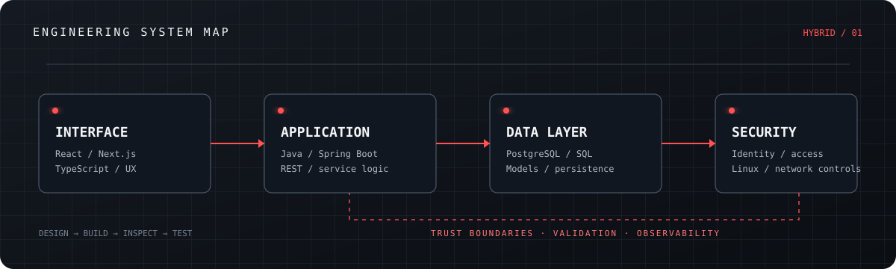

# KAVYANJALI

### SOFTWARE ENGINEERING  /  CYBERSECURITY

**I design and build software systems — then examine the boundaries that keep them reliable and secure.**

[GitHub](https://github.com/Kavyanjali07) &nbsp; / &nbsp; [LinkedIn](https://www.linkedin.com/in/kavyanjali07) &nbsp; / &nbsp; [Portfolio](https://github.com/Kavyanjali07/Portfolio)

<strong>ENGINEERING NOTE 001</strong> &nbsp; • &nbsp; HYBRID SOFTWARE + SECURITY

---

## 01 / ENGINEERING POSITION

I'm a Computer Science student working across **backend engineering, full-stack product development, and cybersecurity**.

My projects sit at the intersection of building functionality and understanding its underlying system: API boundaries, identity and access, data flow, operating-system behaviour, network controls, and the user experience around them.

I prefer to understand the whole path — from interface to API to persistence — rather than treat each layer as an isolated task.

## 02 / SYSTEMS I WORK ON

| DOMAIN | ENGINEERING FOCUS | TOOLS I USE |
|:--|:--|:--|
| **Backend systems** | REST APIs, authentication, persistence, service logic | Java, Spring Boot, Hibernate |
| **Application security** | Identity, authorization, token handling, validation | Spring Security, JWT |
| **Full-stack products** | Interface design, API integration, data visualisation | React, Next.js, TypeScript |
| **Systems & networks** | Linux, connection monitoring, firewall rules, command boundaries | Python, C++, Linux |
| **Data & delivery** | Relational data, version control, builds and containers | PostgreSQL, MySQL, Git, Docker |

## 03 / SELECTED ENGINEERING WORK

### 01 — SmartExpenseAI
**Full-stack application / Personal finance**

A finance-management application combining a Spring Boot API and a Next.js interface. The project explores expense workflows, budgets, analytics, CSV handling, and AI-assisted insights.

**JAVA 17** · **SPRING BOOT** · **SPRING SECURITY** · **NEXT.JS** · **REACT** · **SQL**

[REPOSITORY →](https://github.com/Kavyanjali07/SmartExpenseAI)

---

### 02 — Dynamic Firewall Rule Generator
**Security tooling / Network behaviour**

A Python desktop tool that reads active network connections, tracks connection patterns, flags heuristic anomalies, and can create firewall rules through platform-specific commands.

The current implementation uses psutil, SQLite, Tkinter, Windows netsh, and Linux iptables. Its detection logic is experimental and threshold-based — not a validated intrusion-detection system.

**PYTHON** · **PSUTIL** · **SQLITE** · **TKINTER** · **IPTABLES**

[REPOSITORY →](https://github.com/Kavyanjali07/Dynamic-Firewall-Rule-Generator)

---

### 03 — User-Friendly System Call Interface
**Systems programming / Command boundaries**

An educational C++ project exploring user records, command allowlisting, and audit logging. The current version has known weaknesses in password storage and command execution; those limitations are documented rather than presented as solved security controls.

**C++** · **OPENSSL** · **LINUX** · **COMMAND EXECUTION**

[REPOSITORY →](https://github.com/Kavyanjali07/User-Friendly-System-Call-Interface-for-Enhanced-Security)

---

### 04 — ORBIT (repository: PULSE)
**Interactive product experience / 3D information interface**

An experimental React and Three.js experience that visualises a source-monitoring concept through a 3D network, change-detection story, and interactive demo workspace.

**REACT 19** · **VITE** · **THREE.JS** · **FRAMER MOTION**

[REPOSITORY →](https://github.com/Kavyanjali07/PULSE)

---

### 05 — Travel Graph
**Algorithms / Route optimisation**

A Python route-planning application that models Indian cities as a weighted graph and demonstrates shortest-path and traversal strategies, including Dijkstra, BFS, and DFS.

**PYTHON** · **GRAPHS** · **DIJKSTRA** · **BFS** · **DFS**

[REPOSITORY →](https://github.com/Kavyanjali07/Travel-graph)

---

### 06 — Portfolio
**Frontend engineering / Interaction design**

The source code for my portfolio, built with Next.js, TypeScript, Tailwind CSS, animation libraries, and interactive visual effects.

**NEXT.JS** · **TYPESCRIPT** · **TAILWIND** · **GSAP**

[REPOSITORY →](https://github.com/Kavyanjali07/Portfolio)

## 04 / CURRENT BUILD

**KnowledgeNetwork — collaborative knowledge graph**

A full-stack knowledge-management project exploring graph and node management, interactive graph layouts, visibility controls, authentication, and workspace-level access.

Current development stack: Java / Spring Boot, React / TypeScript, and PostgreSQL.

The repository is private while the project is being developed and reviewed. It will be presented publicly only after its implementation, configuration, and security posture are ready for review.

## 05 / ENGINEERING PRINCIPLES

    TRACE THE DATA FLOW       Understand how information moves.
    DEFINE TRUST BOUNDARIES   Make identity and permissions explicit.
    TEST THE FAILURE PATHS   Verify behaviour beyond the happy path.
    DOCUMENT THE REAL SYSTEM Describe what the code actually does.

## 06 / CURRENT LEARNING TRACK

- Java backend architecture and Spring Security
- Secure authentication, authorization, and session design
- Graph data structures and application architecture
- Linux networking and practical security tooling
- Automated testing, CI/CD, and deployment fundamentals

---

**OPEN TO SOFTWARE ENGINEERING • BACKEND • FULL-STACK • SECURITY-FOCUSED ROLES**

[CONNECT ON LINKEDIN](https://www.linkedin.com/in/kavyanjali07)

BUILD → INSPECT → TEST → IMPROVE &nbsp; / &nbsp; LAST UPDATED: 2026

